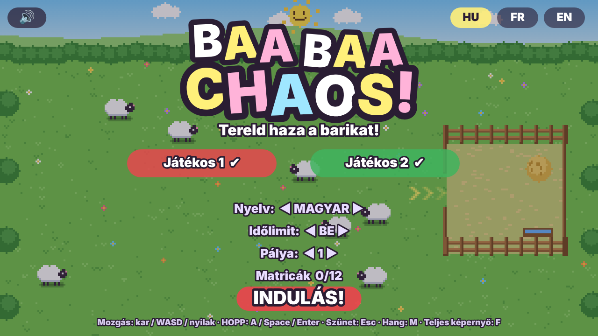
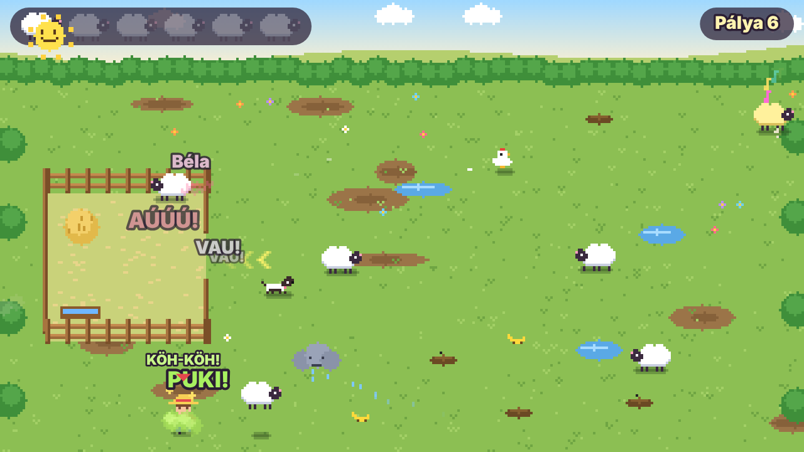
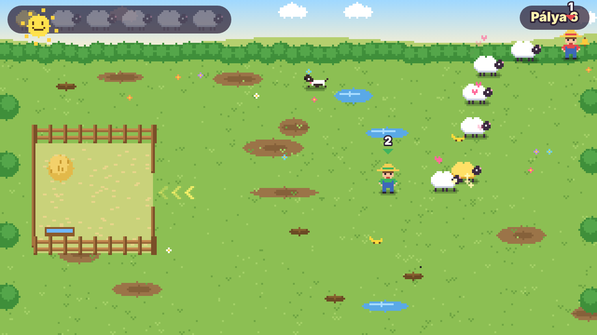
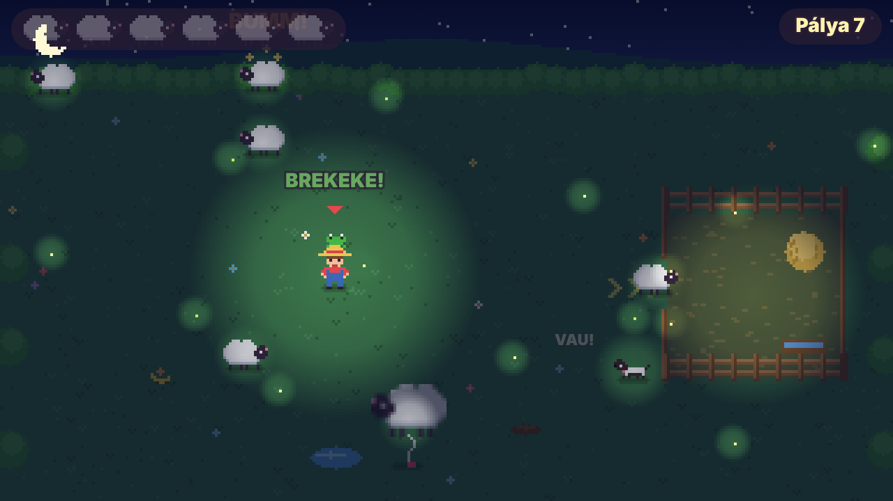
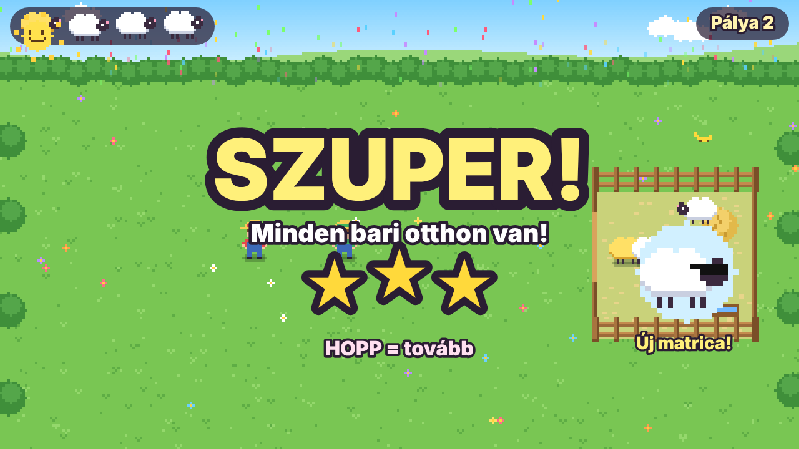
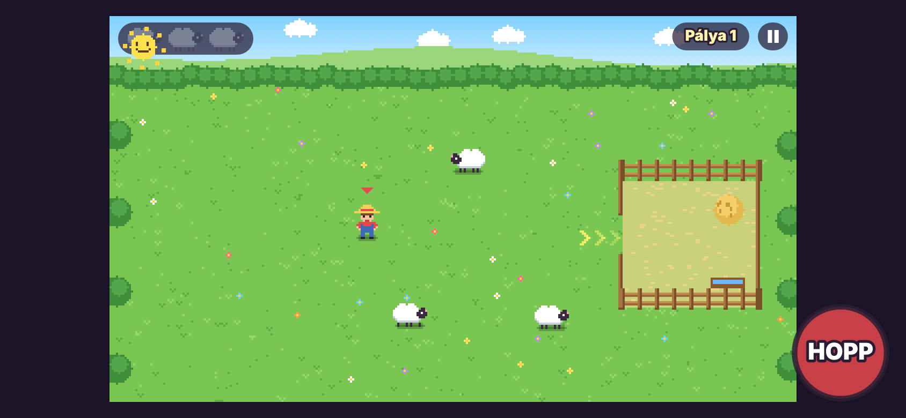

# 🐑 Baa Baa Chaos

**Herd the sheep back home!** A silly pixel-art sheep-herding game for 1–2 players, made for little kids and their parents.

### ▶️ [Play now in your browser](https://rblackwood224.github.io/BaaBaaChaos/)

No download, no install, no ads, no data collected. Works on PC, TV, phone and tablet.

---

## 🎯 How to play

The sheep escaped from their pen and scattered across the meadow. Work together to herd them all back before the sun goes down!

- Sheep **run away from the farmers**, so walk behind them and push them toward the pen.
- The **yellow arrows** show the pen's entrance.
- Shout **HUP!** to make nearby sheep jump away from you.
- The little sheep icons in the top-left corner light up as each sheep gets home.
- You can't really lose: if the sun sets, the farmers fall asleep and you try again. The time limit can be switched off in the menu.

## 🎮 Controls

| Device | Move | Shout (HUP) |
|---|---|---|
| Any gamepad | Left stick / D-pad | A / B / X / Y |
| Keyboard – Player 1 | W A S D | Space |
| Keyboard – Player 2 | Arrow keys | Enter |
| Phone / tablet (1 player) | Drag your finger, the farmer follows | Big red HUP button |

To join, each player presses their own HUP button on the title screen.
**Esc** / Start = pause · **M** = sound on/off · **F** = fullscreen

## 😂 The chaos

All sheep look the same, so you never know who does what until you touch them!

- 💨 **Farting sheep** – the farmer gets dizzy, but the stink cloud also scatters the other sheep. Use it wisely!
- 🐸 **Frog** – jumps on your head. You can only hop around, but every landing goes *THUD* and scares sheep far away.
- 🍌 **Banana peel** – slip and send sheep flying like bowling pins, maybe right into the pen.
- 💩 **Cow pie** – slows you down and makes you stinky, so sheep run from you sooner.
- 🎈 **Balloon sheep** – grab its string, tow it over the pen and pop it with HUP.
- 🕺 **Disco sheep** – the music pulls the others in, and they all dance in one big group.
- 😴 **Sleepy sheep** – yawning is contagious!
- 🚀 **Rocket sheep** – zooms around until it crashes into a fence and gets dizzy.
- 💧 **Puddles** – sheep love splashing in them and won't leave.
- 🌧️ **Rain cloud** – follows a farmer, and soaked sheep slow down.
- 🐔 **Chicken** – catch it for an egg and +10 seconds.
- 🐺 **Wolf** – steals a sheep. Shout HUP to scare it off, and the rescued sheep will follow you.

## ✨ Extras

- ✋ **High five** – both farmers shout HUP next to each other for a speed boost.
- 🔔 **Cowbell** – every free sheep follows you in a conga line.
- 🐕 **Sheepdog** – a helper from level 6 (sometimes takes a nap).
- 🌟 **Golden sheep** – rare, shiny and fast.
- ⭐ **1–3 stars** per level and **12 silly stickers** to collect.
- 🏷️ Every sheep has a name.

## 🌍 Languages

English · Magyar · Français – choose on the title screen.

---

## 🇭🇺 Magyarul

**Tereld haza a barikat!** Vicces pixel art terelős játék 1–2 játékosnak, kisgyerekeknek és szüleiknek.
**[Játék indítása](https://rblackwood224.github.io/BaaBaaChaos/)** – telepítés nélkül, böngészőben, telefonon és tableten is.
Irányítás: kontroller, billentyűzet (WASD + Space, nyilak + Enter) vagy érintés. A HOPP gombbal ijesztheted el a barikat. Kicsiknek érdemes kikapcsolni az időlimitet a menüben.

## 🇫🇷 En français

**Ramène les moutons à la bergerie !** Un jeu de bergers rigolo en pixel art pour 1 à 2 joueurs, pour les petits et leurs parents.
**[Jouer maintenant](https://rblackwood224.github.io/BaaBaaChaos/)** – sans installation, dans le navigateur, aussi sur téléphone et tablette.
Commandes : manette, clavier (WASD + Espace, flèches + Entrée) ou écran tactile. Le bouton HOP fait fuir les moutons. Pour les tout-petits, désactive la limite de temps dans le menu.
